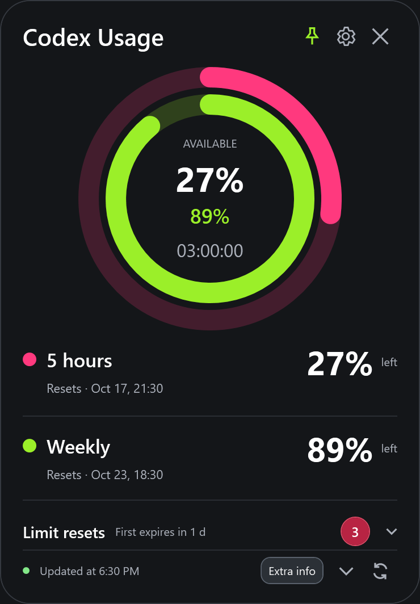
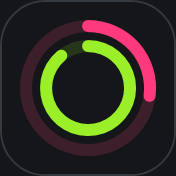

# Codex Usage Widget

A small Windows desktop companion that keeps your Codex subscription limits visible. Two Activity-inspired rings show **quota remaining**: full means all quota is available, empty means none. The numbers show the same remaining percentage and the dates show the next reset in your local time zone.



> Independent open-source utility, not an official OpenAI application. The screenshot uses demonstration data. Subscription quota percentages are not a count of tokens remaining.

## Features

- Five-hour and weekly Codex quota windows, remaining percentages and local reset dates.
- Automatic polling every minute by default, plus app-server rate-limit notifications.
- Pink and lime vector rings with short, interruptible animations; Windows animation preferences are respected.
- Full and compact ring layouts, with a live five-hour reset countdown in HH:mm:ss format at their centers.
- Draggable windows, optional always-on-top, matching dark tooltips and a system tray menu.
- Shared rounded dark Settings and reset confirmation windows, using native XAML CenterOwner placement.
- A two-ring application icon, supplied in multiple resolutions for Windows and the tray.
- Monitor-aware window bounds, larger compact rings and a countdown that pauses while hidden in the tray.
- A fully collapsible earned-reset section with a red available-count badge; each row shows expiry and its own action, always protected by confirmation.
- Remembers window position, layout, CLI path and refresh interval.
- Optional start with Windows, enabled only when you check it in Settings.
- Retains the last successful snapshot during an outage and marks it as stale.
- Available earned resets and the earliest known expiry date, with an explicit reset action and confirmation.
- English by default, with Russian, Ukrainian, Serbian (Cyrillic), French, German, Simplified Chinese and Japanese in Settings.
- Monitoring does not start prompts or model requests. A reset is spent only after you confirm the reset action.



## Quick start

1. Download `CodexUsageWidget-win-x64.zip` from [Releases](https://github.com/krislechy/CodexUsageWidget/releases).
2. Extract the ZIP and run `CodexUsageWidget.exe`. Keep the extracted files together.
3. Have the official Codex CLI installed and signed in with your ChatGPT account:

   ```powershell
   codex --version
   codex login
   ```

The portable package includes the .NET runtime and uses compression. The `-lite` package requires the **Microsoft .NET 10 Desktop Runtime (Windows x64)**, available from [Microsoft](https://dotnet.microsoft.com/en-us/download/dotnet/10.0). Neither package includes Codex CLI. Builds are currently unsigned. See [package size](docs/package-size.md) for the size breakdown and tradeoffs. A local build never updates GitHub; publication requires an explicitly authorized command.

If the widget cannot find Codex, open the gear button and select `codex.exe` or `codex.cmd`. An empty path searches `PATH`, preferring a native executable. You can also set `CODEX_USAGE_WIDGET_CODEX_PATH`.

### Controls

| Control | Action |
| --- | --- |
| Drag the window background | Move the widget |
| Pin | Toggle always-on-top |
| Gear | Open Settings |
| Reset limits in the expanded widget | Confirm spending one earned reset |
| Chevron / Ctrl+M | Switch between full and compact views |
| Double-click compact background | Expand the widget |
| Double-click expanded rings | Switch to compact view |
| Refresh / Ctrl+R | Refresh immediately |
| Close / Escape / Alt+F4 | Hide to the tray; updates continue |
| Left-click tray icon | Show the widget |
| Tray → Exit | Stop the widget and its child app-server |

Hover the compact widget for quota reset dates, earned reset availability/expiry and update status. Its center shows the five-hour reset countdown, refreshed every second. Unknown reset time shows `--:--:--`; elapsed time stays at `00:00:00` until fresh server data arrives. The tray menu contains Show, Full/compact, Settings and Exit. A second launch does not create a duplicate widget; use the tray icon to show the existing instance.

### Earned resets

The reset section uses Codex's authoritative `availableCount`. When Codex supplies all expiry dates it shows the earliest expiry; if the detail list is capped or incomplete, it explicitly labels the earliest **known** date. Missing metadata stays unknown. Resetting requires a usable returned credit ID and current quota data; a stale snapshot cannot start a new reset.

Each reset row opens mandatory confirmation naming its expiry, with Cancel as default. The selected returned credit is checked again after confirmation, then its ID and an idempotency key are persisted before `account/rateLimitResetCredit/consume` is sent. If the answer is lost, **Retry reset** repeats the same persisted request, including after restarting the application. Fresh row actions remain disabled during recovery; missing retry identity blocks sending. Polling never triggers a reset. The widget re-reads authoritative limits after any definitive outcome.

### Languages

Choose the interface language in Settings. The whole interface previews the selection immediately; Save persists it and Cancel restores the previous language. Existing settings without a language field migrate to English. Numbers, dates, errors, tray labels, confirmations and accessibility descriptions follow the selection. Windows system file-picker buttons follow Windows itself.

## How updates work

The widget starts a local `codex app-server --listen stdio://`, performs the `initialize` / `initialized` handshake, then calls `account/rateLimits/read`. It also listens for `account/rateLimits/updated` on that connection. The official protocol is documented in [Codex App Server](https://learn.chatgpt.com/docs/app-server).

Notifications from a separate app-server are **not assumed to reflect activity in every other Codex session**. Periodic polling is the dependable fallback: normally your desktop/CLI usage is reflected within the selected interval plus request time. Choose 30 seconds, 1 minute, 2 minutes or 5 minutes in Settings. Requests time out after 20 seconds; a hung or closed server is recreated on the next refresh.

Quota windows are identified by their durations, not by their primary/secondary slot. The general `codex` bucket is preferred over model-specific limits. A missing window displays an em dash, never an invented 0%. The widget does not assume a reset has happened just because the clock passed the reset date; it waits for fresh values from Codex.

## Build and test

Requires Windows 10/11 and the .NET 10 SDK. There are no third-party NuGet dependencies.

```powershell
dotnet build CodexUsageWidget.sln -c Release
dotnet run --project tests/CodexUsageWidget.Tests -c Release
dotnet run --project src/CodexUsageWidget -c Release
```

Tests are an executable regression suite, not an adapter-based `dotnet test` project. They launch a fake stdio server to exercise handshakes, events, request correlation, timeouts, cancellation, process exit, polling and reset outcomes. They also cover quota/reset metadata, a lost reset response and durable retry identity. Routine verification runs the suite once and captures only English UI. Locale-wide catalog checks are opt-in with `--check-locales`, only when requested. Tests require no login or network access and never spend a real reset.

Optional read-only smoke test with your signed-in Codex CLI:

```powershell
dotnet run --project tests/CodexUsageWidget.Tests -c Release -- --live
```

Prepare both Portable and Lite with tests, English screenshots and checksums:

```powershell
./scripts/release.ps1
# Only after explicit publication authorization:
./scripts/release.ps1 -Commit -Publish
```

Preview with synthetic values, or capture the actual WPF UI without connecting to Codex:

```powershell
dotnet run --project src/CodexUsageWidget -c Release -- --demo
dotnet run --project src/CodexUsageWidget -c Release -- --capture artifacts/screenshots
```

See [release workflow](docs/releasing.md), [architecture](docs/architecture.md), [design system](DESIGN.md), [privacy](docs/privacy.md) and [troubleshooting](docs/troubleshooting.md).

## License

[MIT](LICENSE).

View switches and tray restoration refill the rings from zero while numeric data stays accurate. Windows animation preferences are respected.

### Custom colors and expiry summary

The Colors section in Settings customizes the five-hour ring, weekly ring and widget background. Click a swatch for a preset or type any `#RRGGBB` value. Colors preview immediately; Save persists them, Cancel restores them, and Default colors restores the original palette. Text contrast and ring tracks adapt; dialogs retain their shared dark style.

Limit resets shows the earliest upcoming expiry as `First expires in 1 d` or `First expires in 23 h`. Rows sort earliest first, with undated credits last. Whole days are shown from 24 hours onward; shorter periods use rounded-up hours. Partial metadata says `First known expiry in …`. The tooltip provides the exact local date and time.

Compact expiry units are localized: for example, Russian uses `9 дн.` and `23 ч`. The full summary and exact expiry remain available in the tooltip.

### Extra info (experimental)

Open **Extra info** from the expanded widget footer. The window contains collapsible account, token activity, credit/quota, reset metadata, workspace notice, conversation and notification sections. Account details omit email; no raw API responses or chat contents are stored or logged.

Token activity includes today's reported value, lifetime/peak totals, streaks, longest turn and a 7/30-day chart. Hover a bar for its date and tokens; a missing day remains **Not reported**, not zero. Dates are the dates returned by the service. Quota percentages, historical token totals and purchased credits are distinct measures.

The conversation picker searches local threads and loads additional pages. Selecting a conversation calls the read-only usage endpoint with its ID; model groups show total/input/cached/new-input/output tokens and estimated credits. USD and credit costs are estimates, not final billing. Context-window, reasoning and last-turn values require notifications on this app-server connection; other clients may not stream their activity here. The widget does not resume chats or start model turns to obtain those values.

Extra data refreshes on opening, after account notifications, and every five minutes while visible; it uses the existing authenticated app-server connection. Each optional endpoint can fail independently. Workspace notices and some metrics may be disabled or absent for an account. Unsupported features remain visibly unavailable.

In **Extra info → Notifications**, enable low-quota or earned-reset expiry alerts, choose a remaining-percent threshold (1–99%) or expiry lead time (1–168 hours), and save. These custom app notifications use existing quota polling, require no additional endpoints, and notify once per quota window/threshold or reset per app session. Preferences default to disabled. Popups are independent of Windows notification settings and are not stored in Windows Notification Center. Extra info has no reset action: the existing reset flow still requires confirmation.

### Application updates

Packaged Portable and Lite builds update from [GitHub Releases](https://github.com/krislechy/CodexUsageWidget/releases). Automatic updates are enabled by default and can be disabled in Settings. The first check runs after startup (about 15 seconds), then checks are limited to every six hours across restarts. Only a newer stable release is eligible; drafts, prereleases and older versions are ignored. Lite remains Lite and Portable remains Portable.

Settings also offers **Check for updates** and **Update now**, including when automatic updates are disabled. After checking, Update now becomes available when a compatible release is found. It downloads and verifies the package, saves Settings, closes the application and installs the update. Automatic installation waits while dialogs, quota requests, a reset operation or pending reset recovery are active. Installation needs write access to the application folder; it never elevates privileges. Development builds can check releases but cannot replace a source checkout.

Release ZIPs require a matching `.zip.sha256` asset plus `update-manifest.json`. Only package-owned files are replaced; unrelated files and settings under `%LOCALAPPDATA%\CodexUsageWidget` are preserved. The existing executable is copied as a hidden helper, so no additional updater runtime is bundled. On installation or verified startup failure it restores changed files and starts the previous build. Backups and result reports live under `%LOCALAPPDATA%\CodexUsageWidget\updates`; the most recent successful backup is kept. Sudden power loss during file replacement can require manual recovery from that backup.

GitHub checks send no Codex/account data or authentication token. A failed network check leaves the current application running. Releases missing update metadata cannot be installed automatically. Adding the updater does not publish a release: publication still requires an explicit command.

Quota alerts appear as the app’s own dark popup above the taskbar at the bottom-right of the primary monitor. They do not take focus and remain available while the widget is hidden. Click the notification to restore the widget; its cross only dismisses it. In **Settings**, choose the notification duration from 1 to 60 seconds (default: 5); hovering pauses the timeout, and leaving restarts the timeout. New messages merge into the visible popup. No additional API requests or reset actions are triggered.
